# Sandpit

Sandpit is a suite of physics-based 3D multi-agent environments for reinforcement learning from
pixels. It is built on Godot 4.7 and has a high-throughput Python interface. It includes reference
implementations of PPO, self-play, curriculum learning and a DreamerV3-style world model.

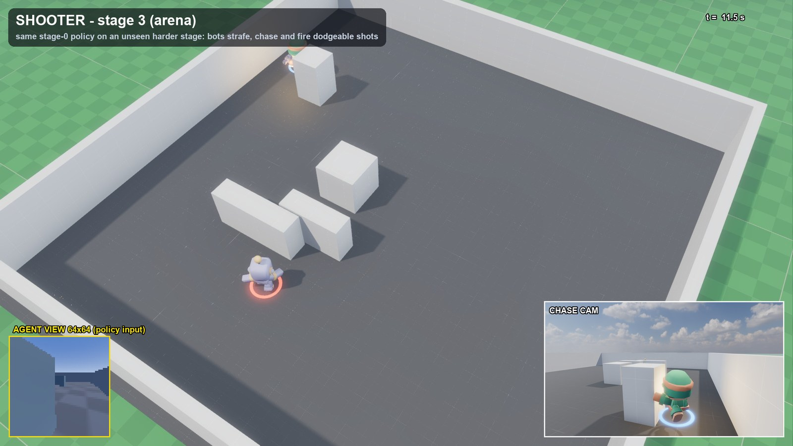

<table>
<tr>
<td width="50%">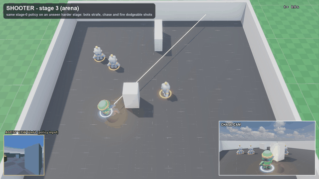<br><sub><b>Shooter.</b> PPO agent trained on stage 0, evaluated on stage 3.</sub></td>
<td width="50%">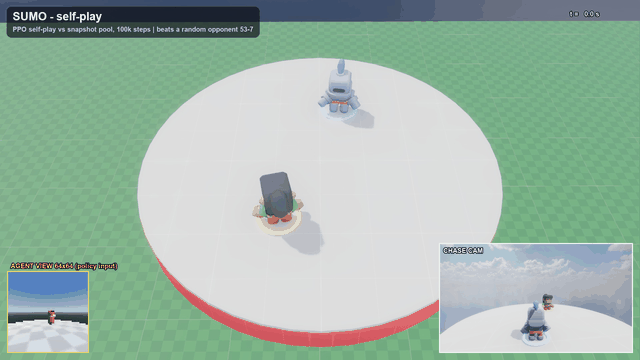<br><sub><b>Sumo.</b> Self-play PPO against an opponent pool.</sub></td>
</tr>
<tr>
<td width="50%">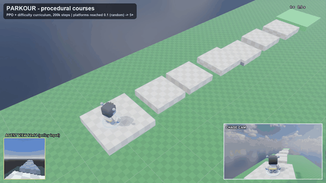<br><sub><b>Parkour.</b> PPO with a difficulty curriculum on procedural courses.</sub></td>
<td width="50%">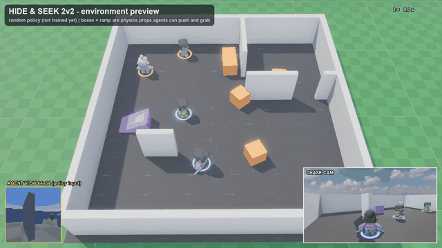<br><sub><b>Hide and seek (2v2).</b> Environment preview, random policy.</sub></td>
</tr>
</table>

Videos are offline re-renders of recorded episodes, shown alongside the agent's 64×64 observation
(yellow frame). Full-resolution clips:
[shooter](media/videos/shooter_cinema.mp4),
[shooter, stage 3](media/videos/shooter_arena_cinema.mp4),
[sumo](media/videos/sumo_cinema.mp4),
[parkour](media/videos/parkour_cinema.mp4),
[hide and seek](media/videos/hideseek_cinema.mp4).

## Overview

Agents perceive the world through a first-person RGB camera and a small proprioceptive vector,
and act through a shared MultiDiscrete action space. All environments share the same agent body
and interface, so architectures and training code transfer between them without modification.

The Python interface talks to Godot through its own lockstep protocol:
* Many arena copies run inside each Godot process, and many processes run in parallel.
* All camera images are returned with a single GPU readback per decision.
* Each observation is guaranteed to reflect the simulation state at the decision tick.

A separate offline renderer re-renders recorded episodes for presentation. It never affects what
the agents observe.

## Environments

| Environment | Agents | Task | Primary action |
|---|---|---|---|
| `shooter` | 1 vs. 1–6 scripted bots | Eliminate bots while avoiding their projectiles. Five curriculum stages: static targets → moving targets → dodging → mixed arena → hard. | Hitscan weapon |
| `sumo` | 1 vs. 1 | Push the opponent off a circular platform. | Shove |
| `tag` | 1 hider vs. 1 seeker | The seeker must tag the hider before time runs out. | Tag / grab |
| `hideseek` | 2 vs. 2 | Hiders avoid line of sight from seekers. Boxes and ramps are movable physics props. Seekers are frozen and blinded during a preparation phase. | Grab / carry |
| `parkour` | 1 | Traverse a procedurally generated platform course. Difficulty controls gap size, height changes, moving platforms and button-operated doors. | — |

### Observation and action spaces

| | Specification |
|---|---|
| Visual observation | 64×64×3 `uint8` first-person camera (the PPO baselines stack 4 frames) |
| Vector observation | 8 shared features (local velocity, grounded, health, cooldown, pitch, time remaining) plus environment-specific features, e.g. damage direction and projectile proximity bins in `shooter` |
| Action space | MultiDiscrete `[3, 3, 5, 3, 2, 2]`: move, strafe, yaw, pitch, jump, primary |
| Control rate | 60 Hz physics, action repeat 4 (15 decisions per second) |
| Episode termination | Same-step auto-reset; remaining time is part of the observation |

## Installation

Requires [Godot 4.7](https://godotengine.org/download), Python 3.12 and [uv](https://docs.astral.sh/uv/).

```bash
brew install --cask godot            # on Linux, download Godot 4.7.2 and set GODOT_BIN
uv venv --python 3.12 && uv sync
uv run pytest -q
```

## Usage

**Interactive play** (WASD, mouse, Space to jump, left click for the primary action):
```bash
godot --path godot -- --mode=human --scenario=shooter --params='{"stage": 3}'
godot --path godot -- --mode=human --scenario=parkour
```

**Training.** Progress is logged to TensorBoard under `runs/`.
```bash
uv run python scripts/train_ppo.py --config configs/shooter_baseline.yaml
uv run python scripts/train_ppo.py --config configs/sumo_baseline.yaml      # self-play
uv run python scripts/train_ppo.py --config configs/tag_baseline.yaml       # two co-trained policies
uv run python scripts/train_ppo.py --config configs/parkour_baseline.yaml   # difficulty curriculum
```

**Evaluation** against a random-action opponent:
```bash
uv run python scripts/eval_vs.py --ckpt checkpoints/sumo_selfplay_ppo.pt
```

**Rendering.** This records an episode with a policy and re-renders it at 1080p. Output goes to
`media/videos/`.
```bash
uv run python scripts/cinema.py --ckpt checkpoints/shooter_stage0_ppo.pt --name shooter
uv run python scripts/watch.py  --ckpt checkpoints/parkour_curriculum_ppo.pt --realtime   # live view
```

**World model:**
```bash
uv run python scripts/train_dreamer.py --mode record --ppo-ckpt checkpoints/shooter_stage0_ppo.pt --data runs/data.npz
uv run python scripts/train_dreamer.py --mode wm --data runs/data.npz
uv run python scripts/train_dreamer.py --mode online
```

**Diagnostics:**
```bash
uv run python scripts/check_env.py     # smoke test of all environments
uv run python scripts/bench.py         # throughput vs. number of Godot processes
uv run python scripts/screenshots.py   # spectator, chase, top-down and observation images
```

## Baseline results

All results were obtained on a single Apple M2 Pro (10 CPU cores, 16 GB) with the configurations
in `configs/*_baseline.yaml`. Each trained policy is compared with a uniformly random policy in
the same environment. Pretrained checkpoints are in `checkpoints/`.

| Experiment | Budget | Metric | Random policy | Trained policy |
|---|---|---|---|---|
| Shooter, stage 0 (PPO) | 300k steps | Episodes won (all bots eliminated) | 3.1% | **99.2%** |
| | | Eliminations per episode | 0.50 | **1.99** |
| Sumo (self-play PPO) | 100k steps | Win rate vs. random opponent | 50% | **88%** (53–7) |
| | | Elo vs. own snapshot pool | 1000 | **≈1180** |
| Parkour (PPO + curriculum) | 200k steps | Platforms reached per course | 0.12 | **5.1** |
| | | Courses completed | 0% | **56%** (difficulty 0.2–0.3) |
| Tag (co-trained PPO) | 300k steps | Hider return vs. random seeker | 0.51 | **2.87** |
| | | Seeker tag rate vs. random hider | 12.5% | 16.7% |
| World model (offline) | 2.5k updates | Image reconstruction error (SSE / frame) | — | 850 → **25** |

<p>
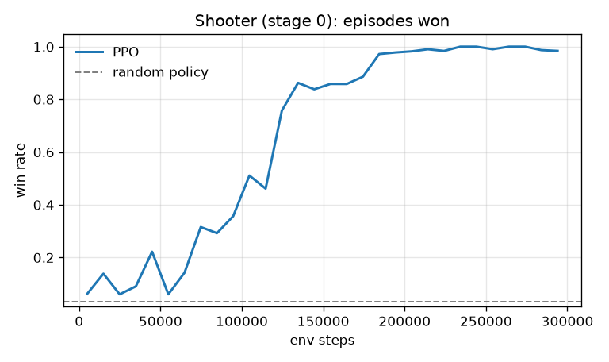
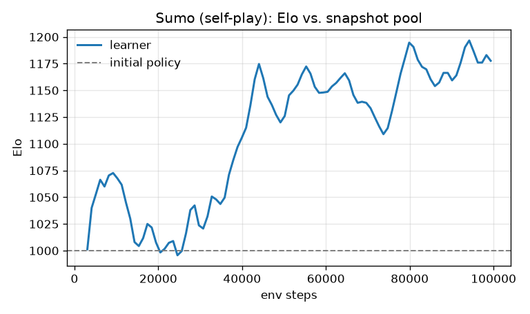
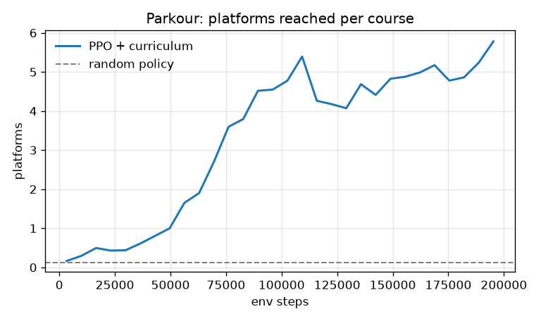
</p>

**World-model predictions.** Top row: ground truth. Bottom row: model output. The first 8 frames
are reconstructions; the remaining frames are open-loop predictions conditioned only on actions.
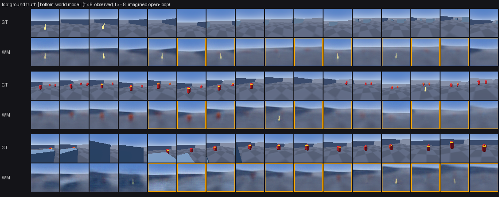

**Observations.** Left: the 64×64 observations of 16 agents during training. Right: spectator,
chase, top-down and observation views of the same environment.
<p>
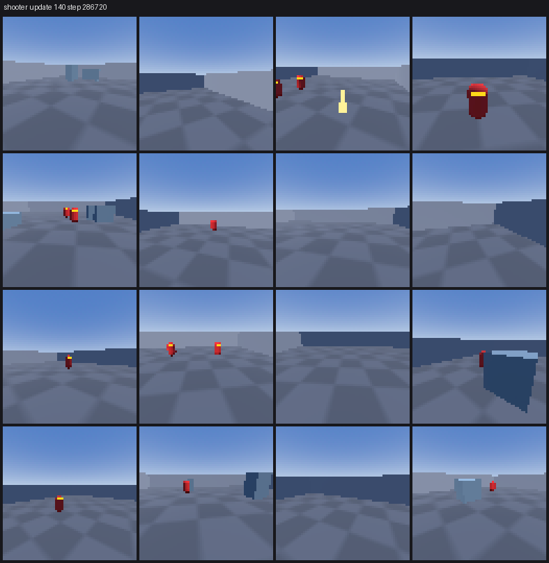
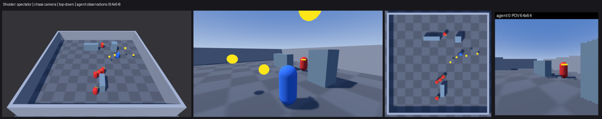
</p>

### Throughput

Agent-steps per second with 64×64 RGB observations and random actions:

| Environment | 1 process | 2 processes | 4 processes | 6 processes |
|---|---|---|---|---|
| shooter (8 arenas / process) | 1,962 | 3,166 | 4,752 | 5,855 |
| sumo (4 arenas / process) | 2,467 | 3,727 | 5,654 | 6,389 |
| tag (4 arenas / process) | 2,521 | 3,712 | 5,567 | 5,585 |
| hideseek (2 arenas / process) | 2,405 | 3,535 | 5,373 | 5,693 |
| parkour (8 arenas / process) | 2,369 | 3,555 | 5,402 | 5,932 |

## System design

**Synchronization.**
* Python launches the Godot processes. Each process hosts several independent arenas.
* After each action, Godot advances exactly `action_repeat` physics ticks.
* Physics runs at `60 × speedup` ticks per wall-clock second with `time_scale = speedup`, so
  simulated time stays at 60 Hz while running as fast as the hardware allows.

**Observation readback.**
* The exchange with Python happens in `_process`, after transform updates have been propagated
  to the renderer.
* Godot renders explicitly with `RenderingServer.force_draw()`, so training is independent of
  window visibility.
* Every agent camera is tiled into one atlas texture, read back once, and split in Python.
* Messages are a JSON header followed by binary arrays: observations, vectors, rewards and
  termination flags.

**Verification.** `tests/test_protocol.py` attaches 8 colored markers to every agent and moves one
of them in front of the camera according to the simulation tick. Each decoded image must match
the tick counter sent in the vector observation, which rules out stale frames and stale
transforms.

**Offline rendering.** In watch mode, node transforms and agent state are recorded every two
ticks. A separate Godot instance using the Forward+ renderer then:
* rebuilds the arena from the same environment script and replays the recording
* replaces the training geometry with animated characters, textured materials, an HDRI sky, soft
  shadows, SSAO/SSIL and particle effects
* renders an overhead observer camera and a chase camera

## Repository structure

```
godot/
  addons/rl_bridge/      synchronization, rendering and protocol (rl_sync.gd)
  common/                agent body and camera, arena base class, geometry helpers
  scenarios/             shooter, sumo, hideseek (tag and hide and seek), parkour
  cinema/                replay recorder, offline renderer, particle effects
  assets/                third-party assets (CC0)
python/sandpit/
  bridge.py, vec_env.py  Godot process management and vectorized environment
  ppo.py, models.py      multi-policy PPO and actor-critic network
  selfplay.py            opponent pool and Elo ratings
  curriculum.py          stage and difficulty curricula
  dreamer/               RSSM world model, imagination actor-critic, replay buffer
scripts/                 training, evaluation, rendering and diagnostics entry points
configs/                 *_baseline.yaml (reported results), *_large.yaml (larger budgets)
checkpoints/             pretrained baseline policies
cloud/                   container definition for Linux GPU machines
tests/                   protocol, synchronization and model tests
```

## Acknowledgements

* [Godot Engine](https://godotengine.org) and Jolt Physics.
* [Kenney](https://kenney.nl): Mini Characters and Prototype Textures (CC0).
* [Poly Haven](https://polyhaven.com): *Kloofendal 48d Partly Cloudy (Pure Sky)* HDRI by Greg
  Zaal and Jarod Guest (CC0).
* The world model follows DreamerV3 (Hafner et al., 2023). The PPO implementation follows the
  structure of CleanRL.
